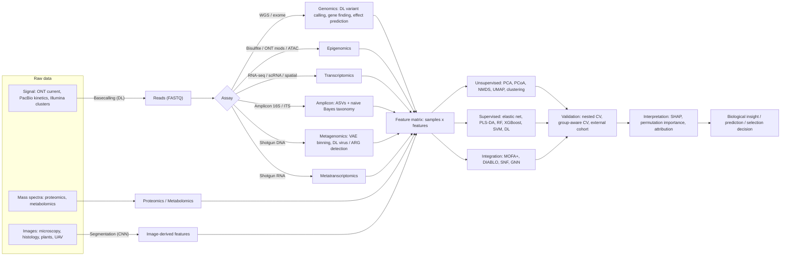
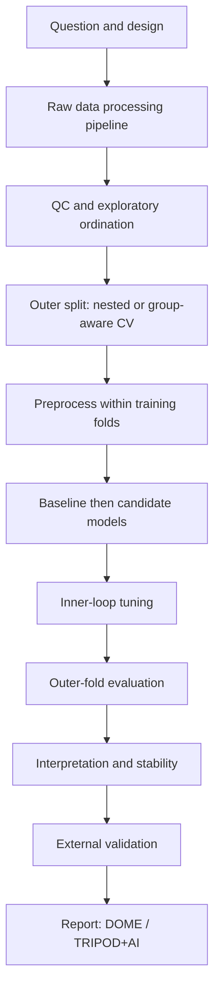

# Machine Learning Methods in Bioinformatics — A Field Guide

*From raw NGS signal to images · genomics → transcriptomics → metagenomics → metatranscriptomics → multi-omics*
*ML4LS — machine learning for life science & agriculture · October 2026*

---

## Contents

- [Machine Learning Methods in Bioinformatics — A Field Guide](#machine-learning-methods-in-bioinformatics--a-field-guide)
  - [Contents](#contents)
  - [1. Legend](#1-legend)
  - [2. The big picture — workflow](#2-the-big-picture--workflow)
  - [3. At a glance](#3-at-a-glance)
  - [4. Core ML method families](#4-core-ml-method-families)
  - [5. Methods by domain](#5-methods-by-domain)
    - [5.1 NGS signal \& read processing](#51-ngs-signal--read-processing)
    - [5.2 Genomics](#52-genomics)
    - [5.3 Quantitative genomics \& breeding (plants \& animals)](#53-quantitative-genomics--breeding-plants--animals)
    - [5.4 Epigenomics](#54-epigenomics)
    - [5.5 Bulk transcriptomics](#55-bulk-transcriptomics)
    - [5.6 Single-cell \& spatial transcriptomics](#56-single-cell--spatial-transcriptomics)
    - [5.7 Proteomics \& protein structure/function](#57-proteomics--protein-structurefunction)
    - [5.8 Metabolomics \& spectroscopy](#58-metabolomics--spectroscopy)
    - [5.9 Amplicon metagenomics (16S / 18S / ITS)](#59-amplicon-metagenomics-16s--18s--its)
    - [5.10 Shotgun metagenomics](#510-shotgun-metagenomics)
    - [5.11 Metatranscriptomics](#511-metatranscriptomics)
    - [5.12 Multi-omics / meta-omics integration](#512-multi-omics--meta-omics-integration)
    - [5.13 Image analysis](#513-image-analysis)
  - [6. Generic ML workflow for omics](#6-generic-ml-workflow-for-omics)
  - [7. Omics-specific pitfalls](#7-omics-specific-pitfalls)
  - [8. Quick decision guide](#8-quick-decision-guide)
  - [9. Software stack](#9-software-stack)
  - [10. Further reading](#10-further-reading)

---

## 1. Legend

| Tag | Meaning | Examples |
|---|---|---|
| **Stat** | Probabilistic / statistical learning | HMM, GMM, EM, Bayesian hierarchical models |
| **ML** | Classical supervised ML | penalized regression, PLS, SVM, random forest, gradient boosting |
| **Unsup** | Unsupervised learning | PCA, PCoA, NMDS, UMAP, clustering |
| **DL** | Deep learning | CNN, RNN/LSTM, transformer, GNN, VAE |
| **FM** | Pretrained foundation / language model | ESM, AlphaFold, Evo 2, Geneformer, UNI |
| *non-ML* | Algorithmic/statistical step, listed for context | alignment, assembly, GLM-based DE testing |

---

## 2. The big picture — workflow

> Two layers of ML run through every omics pipeline: **(1) ML inside the processing tools** (basecallers, variant callers, taxonomic classifiers, binners, segmenters) and **(2) ML on the resulting feature matrix** (prediction, clustering, integration). Most user-level analysis happens in layer 2.

---

## 3. At a glance

| Domain | Workhorse methods | Rising / state-of-the-art (2023–2026) |
|---|---|---|
| NGS signal & reads | CNN + RNN basecallers (CTC/CRF decoding) | Transformer basecallers, signal-level modified-base calling |
| Genomics | CNN variant callers (DeepVariant), HMM gene finders, ensemble pathogenicity scores | Genomic language models (Evo 2, Nucleotide Transformer), AlphaGenome, AlphaMissense |
| Breeding / genomic prediction | GBLUP, rrBLUP, Bayesian alphabet, RKHS | GBM/DL with envirotyping (G×E), plant genomic LMs (AgroNT, PlantCaduceus) |
| Epigenomics | HMM (ChromHMM), elastic-net clocks, CNN TF-binding models | ChromBPNet, base-resolution models + attribution (TF-MoDISco) |
| Bulk transcriptomics | Penalized regression, RF, WGCNA, SVR deconvolution | Sequence-to-expression models (Borzoi), Bayesian deconvolution |
| Single-cell & spatial | PCA → kNN graph → Leiden → UMAP; Harmony; scVI (VAE) | Single-cell foundation models (Geneformer, scGPT), GNN spatial domains |
| Proteomics / proteins | Percolator (semi-supervised SVM), PLS-DA | AlphaFold 3 / Boltz, protein LMs (ESM), transformer de novo sequencing |
| Metabolomics | PLS-DA / OPLS-DA, RF, SIRIUS + CSI:FingerID | Learned spectral embeddings (MS2DeepScore, DreaMS) |
| Amplicon (16S/ITS) | Naive Bayes taxonomy, PCoA/NMDS, RF & LASSO classifiers | Phylogeny-aware DL, cross-study transfer, compositional ML |
| Shotgun metagenomics | GMM/EM binning, RF/LASSO on profiles | VAE & contrastive binning (VAMB, SemiBin2), protein-LM annotation of "dark" genes |
| Metatranscriptomics | GLMs + RF on activity profiles | Transformer-based RNA virus discovery (LucaProt) |
| Multi-omics | MOFA+, DIABLO, SNF | GNN / VAE integration (MOGONET, GLUE), knowledge graphs |
| Images | U-Net, Cellpose / StarDist, RF pixel classifiers, YOLO | SAM-based segmentation, pathology & geospatial foundation models |

---

## 4. Core ML method families

| Family | Methods | Type | Why it suits omics | Typical bioinformatics uses |
|---|---|---|---|---|
| Penalized linear models | LASSO, ridge, elastic net, logistic regression, Cox-LASSO | ML | Sparse, interpretable, handles p ≫ n | Biomarker signatures, epigenetic clocks, microbiome classifiers (SIAMCAT), rrBLUP (= ridge) |
| Latent-variable projection | PCR, PLS-R, PLS-DA, sPLS-DA, OPLS-DA, multi-block PLS | ML | Copes with collinearity, many features | Metabolomics, NIR/hyperspectral, microbiome, DIABLO multi-omics |
| Discriminant / Bayes | LDA, QDA, naive Bayes, nearest centroid | ML | Fast, few parameters | 16S taxonomy (RDP, QIIME 2 classifier), LEfSe, PAM50 |
| Instance-based | k-nearest neighbours | ML | Simple, non-parametric | Doublet detection (Scrublet), label transfer, imputation |
| Kernel methods | SVM, SVR, RKHS regression, Gaussian processes | ML | Non-linear with small n | CIBERSORT (ν-SVR), Percolator, CSI:FingerID, RKHS genomic prediction, SpatialDE (GP) |
| Tree ensembles | Random forest, extra trees, GBM (XGBoost, LightGBM, CatBoost) | ML | Robust default for tabular omics; interactions; importance | Microbiome→phenotype, REVEL, GENIE3/GRNBoost2, scDblFinder, CheckM2, VirSorter2 |
| Probabilistic sequence models | HMM, profile HMM, covariance models (SCFG), CRF | Stat | Model sequential structure | Gene finding (AUGUSTUS), HMMER/Pfam, Infernal/Rfam, ChromHMM, GECCO |
| Mixture & latent models | GMM, EM, Dirichlet-multinomial mixtures, topic models (LDA), NMF, Bayesian hierarchical | Stat / Unsup | Soft assignments, uncertainty | GATK VQSR, CONCOCT, enterotypes, cisTopic, mutational signatures, cell2location |
| Dimensionality reduction | PCA, PCoA, NMDS, ICA, t-SNE, UMAP, PHATE, diffusion maps | Unsup | Visualization, QC, batch detection | Everywhere (ordination, scRNA embeddings, population structure) |
| Clustering | k-means, hierarchical, PAM, DBSCAN/HDBSCAN, Louvain/Leiden, consensus clustering | Unsup | Discover groups | Cell types, enterotypes, OTUs, patient/plant subtypes |
| Network / graphical models | WGCNA, graphical lasso, Bayesian networks, mutual information | Stat / Unsup | Co-expression & interaction structure | WGCNA modules, SPIEC-EASI, GRN inference |
| Convolutional nets | 1D/2D/3D CNN, ResNet, U-Net | DL | Local patterns (motifs, pixels, pileups) | DeepVariant, DeepSEA, SpliceAI, BPNet, Cellpose, plant disease detection |
| Recurrent nets | LSTM, GRU, BiLSTM | DL | Sequential signals | Basecalling, Medaka, DeepBGC, Prosit |
| Transformers | Encoder (BERT-style), decoder (GPT-style), encoder–decoder | DL / FM | Long-range context, transfer learning | Enformer, AlphaFold, ESM, DNABERT-2, Geneformer, scGPT, Casanovo, LucaProt |
| State-space / long-convolution | Hyena, Mamba | DL / FM | Very long DNA contexts at linear cost | HyenaDNA, Caduceus, PlantCaduceus, Evo / Evo 2 |
| Autoencoders | AE, denoising AE, VAE, conditional VAE | DL | Latent representations, denoising, batch integration | scVI/scANVI, VAMB, EVE, DCA, DeepMicro, CellBender |
| Graph neural networks | GCN, GAT, message passing | DL | Graph-structured data (spatial, molecules, PPI) | SpaGCN, STAGATE, DeepFRI, MOGONET, ProteinMPNN, GEARS |
| Contrastive / self-supervised | Siamese nets, SimCLR/DINO-style | DL | Label-free pretraining | SemiBin2, COMEBin, CLEAN, MS2DeepScore, Cell Painting embeddings |
| Generative diffusion | Denoising diffusion models | DL | Generation & structure design | RFdiffusion, AlphaFold 3 structure module |
| Multiple-instance learning | Attention MIL (ABMIL), CLAM, TransMIL | DL | Labels at bag level (slide, sample) | Whole-slide pathology, m6A site detection (m6Anet) |
| Interpretability | Coefficients, permutation importance, SHAP, integrated gradients, DeepLIFT, TF-MoDISco | — | Turn predictions into biology | Biomarker ranking, motif discovery from DL attributions |

---

## 5. Methods by domain

### 5.1 NGS signal & read processing

| Task | ML approach (type) | Widely used tools |
|---|---|---|
| Nanopore basecalling | CNN + LSTM / transformer, CTC/CRF decoding (DL) | Dorado (current), Bonito (research); Guppy (legacy) |
| Modified-base calling from signal | Neural nets on raw signal / kinetics (DL) | Dorado + Remora, DeepSignal / DeepSignal-plant, DeepMod2; PacBio Jasmine |
| PacBio HiFi consensus | Gap-aware transformer (DL) | DeepConsensus |
| Long-read consensus / polishing | RNN (DL) | Medaka |
| Variant recalibration in short-read pipelines | ML scoring of calls (ML) | DRAGEN (ML recalibration), GATK CNNScoreVariants |
| Read alignment, trimming, deduplication | *non-ML* (indexing, dynamic programming) | minimap2, BWA-MEM2, fastp |

### 5.2 Genomics

| Task | ML approach (type) | Widely used tools |
|---|---|---|
| Germline small-variant calling | CNN on pileup images (DL) | DeepVariant, DeepTrio; Clair3 (RNN + CNN, long reads) |
| Somatic variant calling | CNN (DL) | DeepSomatic, NeuSomatic, ClairS |
| Variant filtering | Gaussian mixture model (Stat), CNN (DL) | GATK VQSR, CNNScoreVariants |
| CNV calling | HMM / Bayesian (Stat) | XHMM, GATK gCNV |
| Genome assembly | *non-ML* (graphs); ML only in polishing | hifiasm, Flye + Medaka / DeepConsensus |
| Structural gene prediction | HMM (Stat); CNN/LSTM + HMM (DL) | AUGUSTUS, GeneMark-ETP, BRAKER3; Helixer, Tiberius |
| Transposable-element classification | CNN (DL) | DeepTE (on top of EDTA / RepeatModeler) |
| Non-coding RNA detection | Covariance models / SCFG (Stat) | Infernal + Rfam, tRNAscan-SE |
| Splice-altering variants | Deep residual CNN (DL) | SpliceAI, Pangolin |
| Missense pathogenicity | Logistic regression (ML), RF ensemble (ML), VAE (DL), PLM (FM) | CADD, REVEL, EVE, ESM-1v, AlphaMissense, PrimateAI-3D |
| Sequence → function (regulatory activity, non-coding variant effect) | CNN + transformer (DL) | DeepSEA / Sei, Basenji, Enformer, Borzoi, AlphaGenome |
| Genomic language models | Transformer / state-space (FM) | DNABERT-2, Nucleotide Transformer, HyenaDNA, Caduceus, Evo 2 |
| Plant genomic language models | Transformer / CNN / Mamba (FM) | GPN (Arabidopsis), AgroNT (48 crop genomes), PlantCaduceus |
| Mutational signatures | NMF (Unsup) | SigProfilerExtractor, MutationalPatterns |
| Population structure | PCA, model-based clustering (Unsup / Stat) | PLINK / EIGENSOFT PCA, ADMIXTURE |

### 5.3 Quantitative genomics & breeding (plants & animals)

| Task | ML approach (type) | Widely used tools |
|---|---|---|
| Genomic prediction / selection (additive) | GBLUP, rrBLUP (ridge), Bayesian alphabet: BayesA/B/Cπ, Bayesian LASSO (Stat / ML) | rrBLUP, BGLR, sommer, ASReml-R, BLUPF90 |
| Non-additive / non-linear GP | RKHS (kernel), RF, SVR, GBM, MLP / CNN (ML / DL) | BGLR (RKHS), DeepGS, DNNGP, scikit-learn / tidymodels |
| Genotype × environment | Multi-kernel & reaction-norm models; GBM / DL with environmental covariates (Stat / ML / DL) | BGLR multi-kernel, EnvRtype (envirotyping) |
| GWAS | Linear mixed models (*non-ML*, statistical); whole-genome ridge regression | GEMMA, GCTA, GAPIT (FarmCPU, BLINK), REGENIE |
| Fine-mapping | Bayesian variable selection (Stat) | SuSiE, FINEMAP |
| Polygenic scores | Penalized / Bayesian shrinkage (ML / Stat) | LDpred2, PRS-CS, lassosum |
| High-throughput phenotypes as features | Image-derived traits → GP (see 5.13) | — |

> **Rule of thumb:** for mostly additive traits, DL rarely beats GBLUP / Bayesian models; gains appear with epistasis, G×E, or when adding omics/phenomics layers.

### 5.4 Epigenomics

| Task | ML approach (type) | Widely used tools |
|---|---|---|
| Long-read methylation calling | Neural nets on signal / kinetics (DL) | Dorado / Remora, DeepSignal-plant (CG/CHG/CHH), Jasmine |
| Bisulfite DMR detection | Beta-binomial / smoothing (*non-ML*, Stat) | methylKit, DSS, bsseq, DMRcate |
| Epigenetic clocks / age prediction | Elastic net (ML) | Horvath clock, GrimAge; species-specific animal & plant clocks |
| Chromatin-state segmentation | Multivariate HMM, dynamic Bayesian network (Stat) | ChromHMM, Segway |
| Peak calling & signal denoising | Poisson/NB (Stat); ResNet denoising (DL) | MACS2/3; AtacWorks |
| TF binding / accessibility from sequence | CNN, dilated CNN (DL) + attribution | DeepBind, Basset, BPNet, ChromBPNet, TF-MoDISco |
| 3D genome | CNN from sequence (DL); RF loop calling (ML) | Akita, Orca; Peakachu |
| scATAC-seq | Topic models (LDA), LSI, VAE (Unsup / DL) | cisTopic, ArchR, Signac, PeakVI, SnapATAC2 |

### 5.5 Bulk transcriptomics

| Task | ML approach (type) | Widely used tools |
|---|---|---|
| Transcript quantification | EM algorithm (Stat) | Salmon, kallisto, RSEM |
| Differential expression | Negative-binomial GLMs (*non-ML*) | DESeq2, edgeR, limma-voom |
| Batch correction | Empirical Bayes / factor models (Stat) | ComBat / ComBat-seq, RUVSeq, SVA |
| Co-expression modules | Network + hierarchical clustering (Unsup) | WGCNA |
| Sample classification / biomarker signatures | Elastic net, RF, SVM, XGBoost (ML) | glmnet, ranger, xgboost, caret / tidymodels |
| Survival / prognosis | Cox-LASSO, random survival forest, DeepSurv (ML / DL) | glmnet, randomForestSRC |
| Cell-type deconvolution | ν-SVR (ML), NNLS, Bayesian (Stat) | CIBERSORTx, MuSiC, BayesPrism, EPIC |
| Gene regulatory networks | Tree ensembles, mutual information (ML) | GENIE3, ARACNe |
| RNA modifications (direct RNA) | Multiple-instance NN (DL) | m6Anet, Dorado RNA modification models |
| Expression from DNA sequence | CNN + transformer (DL) | Enformer, Borzoi |

### 5.6 Single-cell & spatial transcriptomics

| Task | ML approach (type) | Widely used tools |
|---|---|---|
| Ambient RNA / empty droplets | Deep generative model (DL); statistical tests | CellBender, SoupX, EmptyDrops |
| Doublet detection | kNN on simulated doublets, GBM (ML) | Scrublet, DoubletFinder, scDblFinder |
| Normalization / feature selection | Regularized NB GLM (Stat) | sctransform, scran |
| Embedding & visualization | PCA, UMAP, t-SNE, PHATE (Unsup) | Seurat, Scanpy |
| Clustering | Leiden / Louvain on kNN graph (Unsup) | Seurat, Scanpy |
| Batch integration | Soft k-means correction, MNN, CCA anchors, VAE (Unsup / DL) | Harmony, Seurat anchors, fastMNN, BBKNN, Scanorama, scVI |
| Cell-type annotation | Logistic regression, correlation-based, transfer learning (ML / DL) | CellTypist, SingleR, Azimuth, scANVI, scArches |
| Trajectory, pseudotime, RNA velocity | Graph methods, dynamical models (Unsup / Stat) | Monocle3, Slingshot, PAGA, scVelo, CellRank |
| Gene regulatory networks | GBM + motif pruning, regularized regression (ML) | SCENIC / pySCENIC, CellOracle |
| Multimodal (CITE-seq, multiome) | VAE, weighted nearest neighbours, factor models | totalVI, MultiVI, Seurat WNN, MOFA+ |
| Perturbation response prediction | VAE, GNN (DL) | scGen, CPA, GEARS |
| Single-cell foundation models | Transformer (FM) | Geneformer, scGPT, scFoundation, UCE — *benchmark against PCA/scVI baselines; zero-shot gains are often modest* |
| Spatial domains | GNN, graph-attention AE, Bayesian (DL / Stat) | SpaGCN, STAGATE, GraphST, BayesSpace, BANKSY |
| Spot deconvolution / cell mapping | Bayesian hierarchical, DL alignment | cell2location, RCTD, CARD, Tangram |
| Spatially variable genes | Gaussian processes (Stat) | SpatialDE, nnSVG, SPARK |
| Segmentation (imaging-based spatial) | U-Net-style CNN; Bayesian on transcripts | Cellpose, Mesmer, Baysor |

### 5.7 Proteomics & protein structure/function

| Task | ML approach (type) | Widely used tools |
|---|---|---|
| PSM rescoring | Semi-supervised SVM (ML); DL features | Percolator, MS²Rescore, Oktoberfest |
| Fragment / retention-time prediction | GBM (ML); RNN / CNN / transformer (DL) | MS²PIP, Prosit, DeepLC, AlphaPeptDeep |
| DIA analysis | Neural-network ensembles (DL) | DIA-NN |
| De novo peptide sequencing | Transformer (DL) | Casanovo, InstaNovo |
| Structure prediction | Transformer / diffusion (FM) | AlphaFold 2/3, RoseTTAFold All-Atom, ESMFold, Boltz-2, Chai-1 |
| Protein embeddings | Protein language models (FM) | ESM-2 / ESM C, ProtT5, ProstT5 |
| Function prediction (GO, EC) | CNN, GCN, contrastive learning (DL); profile HMMs (Stat) | DeepGOPlus, DeepFRI, CLEAN, ProteInfer; InterProScan / Pfam |
| Localization, topology, signal peptides | PLM + CRF (DL) | DeepLoc 2, SignalP 6, DeepTMHMM |
| Structural similarity search | Learned 3Di structural alphabet (VQ-VAE) | Foldseek |
| Protein design | Diffusion, message-passing GNN (DL) | RFdiffusion, ProteinMPNN |
| Protein complexes / interactions | Transformer (FM) | AlphaFold-Multimer, AlphaFold 3 |

### 5.8 Metabolomics & spectroscopy

| Task | ML approach (type) | Widely used tools |
|---|---|---|
| Peak detection & quality filtering | Signal processing (*non-ML*); CNN peak QC (DL) | XCMS, MZmine, MS-DIAL; NeatMS |
| Molecular formula / structure annotation | Kernel learning → DL fingerprints (ML / DL) | SIRIUS + CSI:FingerID, CANOPUS (compound classes) |
| Spectral similarity & library search | Word2vec, siamese NN, transformer (DL) | Spec2Vec, MS2DeepScore, MS2Query, DreaMS |
| In-silico fragmentation | Probabilistic generative model (Stat) | CFM-ID |
| Biomarker discovery / classification | PLS-DA, OPLS-DA, RF, SVM (ML) | MetaboAnalyst, ropls, mixOmics |
| NIR / Raman / FTIR / hyperspectral spectra | PLS-R, SVM, RF, 1D-CNN (ML / DL) | pls, prospectr — grain quality, soil properties, plant stress |

### 5.9 Amplicon metagenomics (16S / 18S / ITS)

*Typical pipeline: nf-core/ampliseq → DADA2 → taxonomy → phyloseq / QIIME 2 → stats & ML.*

| Task | ML approach (type) | Widely used tools |
|---|---|---|
| Denoising to ASVs | Parametric error model (Stat) | DADA2, Deblur, UNOISE3 |
| Taxonomic classification | Naive Bayes on k-mers (ML); learned taxonomic tree (ML) | RDP classifier / DADA2 `assignTaxonomy`, QIIME 2 `q2-feature-classifier`, IDTAXA; SINTAX (k-mer + bootstrap) |
| Transformations | Compositional log-ratios | CLR, ILR, ALR, PhILR; (TSS, CSS, rarefying — debated) |
| Ordination | PCoA (Bray–Curtis, UniFrac, Aitchison), NMDS, PCA on CLR; constrained RDA / CCA / db-RDA (Unsup) | vegan, phyloseq, QIIME 2 |
| Community types | Dirichlet-multinomial mixtures, PAM, topic models (Unsup / Stat) | DirichletMultinomial, enterotyping |
| Differential abundance | Compositional / count models (*non-ML*, Stat) | ANCOM-BC2, ALDEx2, MaAsLin 3, LinDA, corncob; LEfSe (KW + LDA) |
| Phenotype classification / regression | **RF (most used)**, LASSO / elastic net, XGBoost, SVM (ML) | SIAMCAT, mikropml, `q2-sample-classifier`, tidymodels / caret |
| Supervised projection & multi-study | sPLS-DA (on CLR), MINT (ML) | mixOmics |
| Phylogeny-aware models | CNN on tree-structured abundance; autoencoders (DL) | PopPhy-CNN, Ph-CNN, TaxoNN, MDeep, DeepMicro |
| Co-occurrence networks | Graphical lasso, compositional correlation, conditional independence (Stat) | SPIEC-EASI, SparCC, FlashWeave, NetCoMi |
| Functional inference | Phylogenetic hidden-state prediction (Stat) | PICRUSt2, Tax4Fun2; FAPROTAX (lookup) |
| Source tracking | Bayesian Gibbs sampling, EM (Stat) | SourceTracker2, FEAST |
| Longitudinal dynamics | Bayesian dynamical systems (Stat) | MDSINE2 |

> See also the project docs `ML_in_ampliseq_studies.qmd` and `ampliseq_batch_NMDS_PLS.qmd`.

### 5.10 Shotgun metagenomics

| Task | ML approach (type) | Widely used tools |
|---|---|---|
| Read-based taxonomic profiling | k-mer / marker genes (*non-ML*); Bayesian re-estimation; DL classifiers | Kraken2 + Bracken, MetaPhlAn 4, mOTUs; DeepMicrobes, BERTax |
| Assembly | *non-ML* (de Bruijn / overlap graphs) | MEGAHIT, metaSPAdes, metaFlye |
| Gene prediction | Dynamic programming, HMM (Stat) | Prodigal / pyrodigal, FragGeneScan, MetaGeneMark |
| Genome binning | GMM, EM, VAE, contrastive learning (Stat / DL) | MetaBAT2, CONCOCT (GMM), MaxBin2 (EM), VAMB (VAE), SemiBin2, COMEBin; DAS Tool (refinement) |
| MAG quality | Gradient boosting + NN (ML / DL) | CheckM2 |
| MAG taxonomy | Phylogenetic placement (*non-ML*) | GTDB-Tk |
| Virus identification | RF, CNN, hybrid marker + NN (ML / DL) | geNomad, VirSorter2, DeepVirFinder, VIBRANT; CheckV (quality) |
| Plasmid detection | NN, logistic regression (ML / DL) | geNomad, PlasFlow, PlasX |
| Phage–host prediction | Ensemble classifiers, GCN (ML / DL) | iPHoP, CHERRY |
| Antibiotic-resistance genes | DNN (DL) vs. alignment / HMM | DeepARG, HMD-ARG; RGI (CARD), AMRFinderPlus |
| Biosynthetic gene clusters | pHMM rules (Stat), BiLSTM (DL), CRF (Stat) | antiSMASH, DeepBGC, GECCO |
| Functional annotation | Profile HMMs (Stat); protein-LM embeddings for unknown genes (FM) | eggNOG-mapper, KofamScan, HUMAnN 3; ESM embeddings, DeepFRI |
| Host / environment phenotype prediction | RF, LASSO, XGBoost (ML) | SIAMCAT, MetAML — e.g., disease status, soil function, rumen methane |

### 5.11 Metatranscriptomics

| Task | ML approach (type) | Widely used tools |
|---|---|---|
| rRNA removal, mapping, profiling | *non-ML* (alignment) | SortMeRNA, HUMAnN 3, Kraken2 |
| Activity normalized to DNA abundance | Regression with DNA covariate (Stat) | MTXmodel, DESeq2 with DNA offset; RNA/DNA ratios |
| Differential activity | GLMs (*non-ML*) | DESeq2, edgeR, MaAsLin |
| RNA virus discovery | Transformer on protein sequence + structure (DL); profile HMMs (Stat) | LucaProt, RdRp-scan, palmscan |
| Community state / function prediction | RF, elastic net (ML) | tidymodels, scikit-learn, SIAMCAT |
| Co-expression across taxa | Network clustering (Unsup) | WGCNA-style modules, graphical models |
| Metaproteomics (companion layer) | PSM rescoring (ML / DL) | MS²Rescore, Percolator; Unipept (*non-ML*) |

### 5.12 Multi-omics / meta-omics integration

| Strategy | ML approach (type) | Widely used tools |
|---|---|---|
| Unsupervised factor analysis | Bayesian group factor analysis (Stat / Unsup) | MOFA+, iCluster+, JIVE |
| Supervised multi-block | Sparse multi-block PLS-DA (ML) | DIABLO, block.spls (mixOmics) |
| Similarity network fusion | Graph fusion + spectral clustering (Unsup) | SNF, NEMO |
| Late integration / stacking | Per-omic models + meta-learner (ML) | Stacked elastic net / RF; SuperLearner |
| Deep integration | VAE, GCN, graph-linked embeddings (DL) | MOGONET, totalVI / MultiVI, GLUE |
| Microbe–metabolite links | Neural co-occurrence, elastic net (ML / DL) | MMvec, MelonnPan, MiMeNet |
| Meta-omics (MG + MT + MP + metabolome) | MAG-centric matrices → MOFA+ / multi-block PLS | IMP3 (integrated meta-omic pipeline) |

### 5.13 Image analysis

**Microscopy & cell biology**

| Task | ML approach (type) | Widely used tools |
|---|---|---|
| Denoising / restoration | U-Net, self-supervised (DL) | CARE / CSBDeep, Noise2Void |
| Cell & nucleus segmentation | U-Net variants, star-convex polygons, SAM-based (DL / FM) | Cellpose (incl. Cellpose-SAM), StarDist, Mesmer / DeepCell, micro-SAM, nnU-Net |
| Interactive pixel classification | Random forest (ML) | ilastik, Trainable Weka Segmentation, QuPath |
| Object classification & phenotypic profiling | RF (ML); CNN / self-supervised embeddings (DL) | CellProfiler + CellProfiler Analyst, DeepProfiler, DINO features (Cell Painting) |
| Tracking | Detection (DL) + linking (*non-ML*) | TrackMate with StarDist / Cellpose detectors |

**Histopathology**

| Task | ML approach (type) | Widely used tools |
|---|---|---|
| Nucleus segmentation & classification | CNN (DL) | HoVer-Net, StarDist, QuPath |
| Slide-level prediction (diagnosis, mutation, survival) | Multiple-instance learning on foundation-model features (DL / FM) | CLAM, ABMIL, TransMIL; UNI, CONCH, Virchow2, Prov-GigaPath |

**Plant & agricultural phenotyping**

| Task | ML approach (type) | Widely used tools |
|---|---|---|
| Disease / pest classification | Fine-tuned CNN / ViT (DL) | ResNet, EfficientNet, ViT; PlantVillage, PlantDoc datasets |
| Detection & counting (fruits, spikes, seeds, insects) | One- / two-stage detectors (DL) | YOLO (v8–v11), Faster / Mask R-CNN (Detectron2) |
| Leaf, plant & root segmentation | Naive Bayes pixel classifier (ML); U-Net, SAM (DL) | PlantCV, RootPainter, SAM |
| Hyperspectral / multispectral imaging | PLS-R, SVM, RF (ML); 1D/3D-CNN (DL) | — (stress, nutrient status, quality traits) |
| UAV & satellite remote sensing | RF, GBM (ML); CNN, U-Net, temporal transformers (DL); geospatial FM | Google Earth Engine classifiers, Prithvi |
| 3D phenotyping (point clouds) | PointNet-style networks (DL) | — |

**Animal science & behaviour**

| Task | ML approach (type) | Widely used tools |
|---|---|---|
| Pose estimation & behaviour | CNN / transformer keypoint models (DL) | DeepLabCut, SLEAP |
| Detection, identification, body condition | CNN detectors / classifiers (DL) | YOLO, fine-tuned ResNet |

---

## 6. Generic ML workflow for omics

1. **Define the question** — unit of prediction (sample, subject, plot, cell); target type (class, continuous, survival, time series); what decision the model supports.
2. **Design** — sample size, confounders (batch, run, extraction kit, site, field, season, year); decide the hold-out strategy *before* looking at results.
3. **Process raw data** — domain pipeline (e.g. nf-core/ampliseq, nf-core/rnaseq, nf-core/mag) → feature table + metadata.
4. **QC & exploration** — PCA / PCoA / NMDS coloured by batch *and* biology; outliers; library size; missingness.
5. **Preprocess inside cross-validation** — prevalence/variance filtering, normalization (CLR, VST, log-CPM), scaling, imputation, batch correction.
6. **Split** — nested CV; group-aware folds (GroupKFold by subject / field / family / study); stratify by class; leave-one-study-out (LOSO) or leave-one-batch-out for generalization.
7. **Baselines first** — majority class / mean; penalized logistic or linear regression; then RF / XGBoost; DL only with large n or pretrained embeddings.
8. **Tune** — inner-loop grid / random / Bayesian search (tune, Optuna).
9. **Evaluate** — AUROC, **AUPRC**, balanced accuracy, MCC (classification); RMSE, R², Pearson r (regression / genomic prediction accuracy); calibration; repeated CV or bootstrap CIs; label-permutation test.
10. **Interpret** — coefficients, permutation importance, SHAP, stability selection across folds; DL attributions → motifs (TF-MoDISco).
11. **Validate externally** — independent cohort, site, season, or breeding cycle.
12. **Report & reproduce** — DOME and TRIPOD+AI checklists; seeds, versions, containers; share code and data.

---

## 7. Omics-specific pitfalls

| Pitfall | Where it bites | Mitigation |
|---|---|---|
| p ≫ n | All omics | Penalization, filtering inside CV, simpler models, stability selection |
| Compositionality | Amplicon, metagenomics, cell proportions | CLR / ILR, log-ratio-aware methods; avoid Pearson on relative abundances |
| Sparsity / zero inflation | Microbiome, scRNA-seq | Prevalence filtering, careful pseudocounts, zero-aware models |
| Batch confounded with labels | Sequencing run, kit, field season | Balanced design, batch as CV group, ComBat / MMUPHin, check ordinations |
| Data leakage | Normalization or feature selection on all data; same subject/plant/family in train and test; duplicate samples | sklearn `Pipeline` / tidymodels `recipes`; GroupKFold |
| Class imbalance | Disease cohorts, rare phenotypes | AUPRC, MCC, class weights, stratified folds |
| Population / phylogenetic structure | GWAS, genomic prediction, microbial genomes | Structure-aware CV, PCs as covariates, phylogenetic blocking |
| Deep learning on small n | Most agri & clinical omics studies | Pretrained embeddings, transfer learning, augmentation — or stay classical |
| Misleading importance | RF impurity importance with correlated / high-cardinality features | Permutation / conditional importance, SHAP, stability across folds |
| Benchmark hype | Foundation models | Always compare with simple baselines on your own data |

---

## 8. Quick decision guide

| You have… | Start with | Then try |
|---|---|---|
| 16S/ITS table + binary phenotype (n ≈ 50–500) | CLR → elastic-net logistic regression and RF (SIAMCAT / mikropml) | XGBoost; sPLS-DA for visualization; LOSO if multi-study |
| Shotgun functional profiles + continuous trait | Elastic-net / RF regression | GBM; MOFA+ with metabolome |
| SNP matrix + yield / quality trait | GBLUP / rrBLUP | Bayesian alphabet, RKHS; GBM / DL for epistasis or G×E |
| Bulk RNA-seq, two groups | DESeq2 for DE; elastic-net classifier for prediction | RF / SVM with nested CV; WGCNA modules as features |
| scRNA-seq across batches | Scanpy / Seurat + Harmony or scVI | CellTypist / scANVI labels; foundation-model embeddings vs. baseline |
| Several omics on the same samples | MOFA+ (unsupervised) | DIABLO (supervised), stacking |
| Microscopy needing segmentation | Pretrained Cellpose / StarDist | Fine-tune on own labels; ilastik RF for quick jobs |
| Images needing classification, few labels | Pretrained CNN / ViT features + logistic regression | Fine-tune; MIL for slide- or plot-level labels |
| DNA sequence → regulatory activity | BPNet-style CNN | Fine-tune a genomic LM (Nucleotide Transformer, AgroNT, PlantCaduceus) |
| Unannotated proteins | ESM embeddings + kNN / logistic regression | Foldseek + AlphaFold structures; CLEAN for EC |
| NIR / hyperspectral spectra | PLS-R | SVM / RF, 1D-CNN |

---

## 9. Software stack

| Purpose | R | Python |
|---|---|---|
| General ML | tidymodels, mlr3, caret, glmnet, ranger, xgboost | scikit-learn, XGBoost, LightGBM, CatBoost |
| Deep learning | torch for R, keras3 | PyTorch, Lightning, JAX, PyTorch Geometric, Hugging Face Transformers |
| Multivariate / ecology | mixOmics, ropls, vegan, ade4 | scikit-bio, scikit-learn decomposition |
| Microbiome | phyloseq, microbiome, SIAMCAT, mikropml, ANCOMBC, Maaslin3 | QIIME 2 (q2-sample-classifier), scikit-bio |
| Single-cell & spatial | Seurat, SingleCellExperiment, scran, BayesSpace | Scanpy, scvi-tools, AnnData / MuData, Squidpy |
| Multi-omics | MOFA2, mixOmics (DIABLO), SNFtool | mofapy2, muon |
| Genomic prediction | BGLR, rrBLUP, sommer, ASReml-R | scikit-learn regressors, PyTorch / JAX DL |
| Interpretability | DALEX, iml, vip, fastshap | SHAP, Captum, tfmodisco-lite |
| Workflow & reproducibility | targets, renv, Quarto | Snakemake, Nextflow / nf-core, MLflow, Optuna |

---

## 10. Further reading

- Greener JG et al. (2022) A guide to machine learning for biologists. *Nat Rev Mol Cell Biol*.
- Whalen S et al. (2022) Navigating the pitfalls of applying machine learning in genomics. *Nat Rev Genet*.
- Eraslan G et al. (2019) Deep learning: new computational modelling techniques for genomics. *Nat Rev Genet*.
- Walsh I et al. (2021) DOME: recommendations for supervised machine learning validation in biology. *Nat Methods*.
- Heumos L et al. (2023) Best practices for single-cell analysis across modalities. *Nat Rev Genet*.
- Gloor GB et al. (2017) Microbiome datasets are compositional: and this is not optional. *Front Microbiol*.
- Topçuoğlu BD et al. (2020) A framework for effective application of machine learning to microbiome-based classification problems. *mBio*.
- Wirbel J et al. (2021) Microbiome meta-analysis and cross-disease comparison enabled by the SIAMCAT machine learning toolbox. *Genome Biol*.
- Montesinos-López OA et al. (2021) A review of deep learning applications for genomic selection. *BMC Genomics*.

---

*Tool landscape as of mid-2026; check versions before use — basecallers, foundation models and single-cell tools change quickly.*
